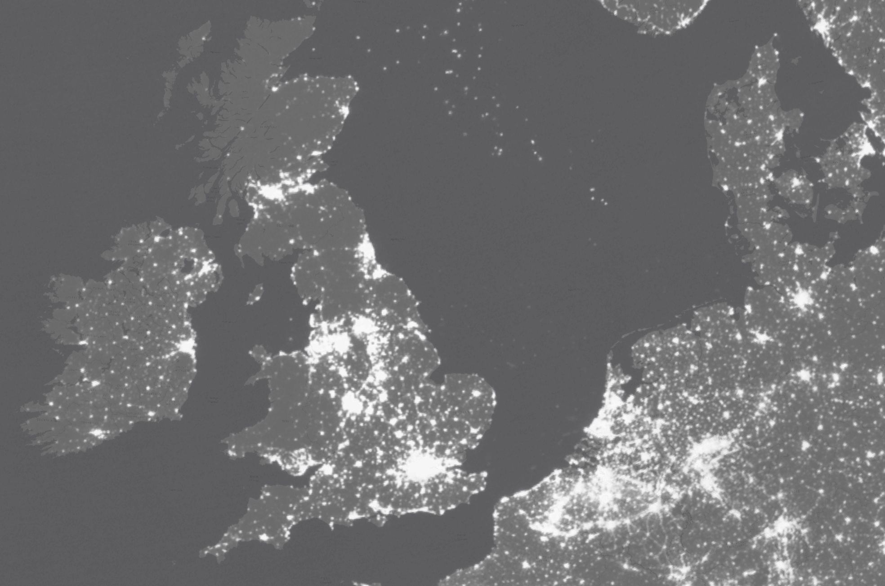
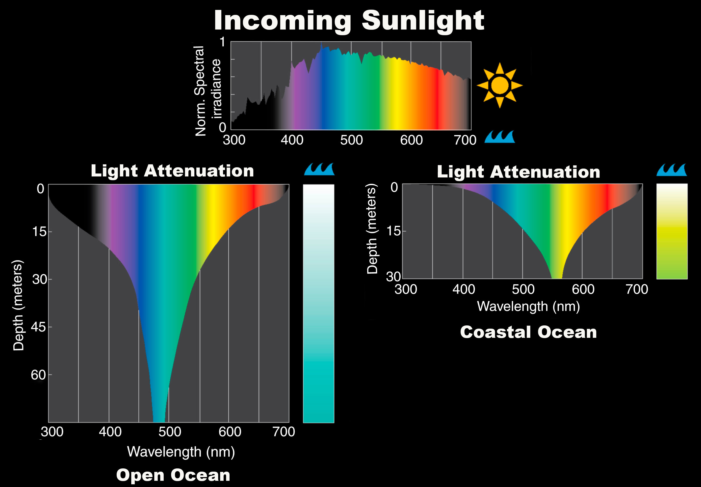

# ALAN - Artificial Light at Night

```{r}
#| include: false
source(here::here("_common.R"))
```

```{r, include = FALSE}
knitr::opts_chunk$set(message=FALSE, warning = FALSE, echo = FALSE)
```

```{r}
library(tidyverse)
library(here)
```





For good overviews on the ecological impact of artificial light at night in the marine environment, see Davies *et al*. [-@davies2014] and Marangoni *et al*. [-@marangoni2022].

For a striking specific example of of the extent of the problem, see for example the report Bright Lights Dim Justice [-@environmentaljusticefoundation2025] by The Evironmental Justice Foundation on the concentration of hundreds of fishing, boats in the south Atlantic, most of them hunting short fin squid using a technique known as jigging in which very bright lights are shone directly down into the water to attract the squid.

Gaston *et al.* [-@gaston2021] asserts that the biological impacts of ALAN in marine systems seem likely to be at least as diverse as those occurring terrestrially, with evidence already for:

## Effects on timing of coral spawning

Corals are known to use broadcast spawning as part of the reproductive cycle. It is important therefore that the release of male and female spawn is synchronised. Some coral species achieve this synchrony by using cycles of light levels determined by phases of the moon. Ayalon *et al*. [-@ayalon2021] show that artifical light at night can drown out this natural signal, causing asynchronous release of spawn and thus loss of reproductive success.

## Invertebrate settlement

Davies *et al* [-@davies2015] present evidence that light at night can alter the composition of epifaunal marine invertebrate communities. They conducted controlled experiments in which LED lighting at intensities typically experienced in inshore waters was shone on roughened PVC panels suspended underwater. LED lighting affected colonisation of 39% of the taxa studied. Some were deterred from colonising, some were encouraged. Their findings suggest that the global surge in broadband LED light pollution from shipping, offshore rigs, and harbours is actively re-structuring underwater ecosystems by interfering with the light-guided cues larvae use to find homes.

## Behavior of pelagic organisms

See Berge *et al.* [-@berge2020]

In the Arctic Polar Night the moon, stars and aurora borealis may provide important cues to guide distribution and behaviours of organisms, including predator-prey interactions. With a changing climate and increased human activities in the Arctic, such natural light sources will in many places be masked by the much stronger illumination from artificial light. The authors show that normal working-light from a ship may disrupt fish and zooplankton behaviour down to at least 200 m depth across an area of \>0.125 km2 around the ship. They conclude that biological surveys in the dark from illuminated ships may introduce biases on biological sampling, bioacoustic surveys, and possibly stock assessments of commercial and non-commercial species.

## Turtle nesting and orientation

Light from coastal developments attracts turtle hatchlings more powerfully than natural attractors such as wave direction and currents so that even if they make it as far as the water once they hatch they remain for longer in the hazardous inshore waters than they otherwise would, making them more vulnerable to predation..

See [@thums2016, @vandersteen2020]

## Seabird grounding and mortality

ALAN can attract marine bird fledglings.

Grounding of thousands of newly fledged petrels and shearwaters (family Procellariidae) in built-up areas due to artificial light is a global problem. Due to their anatomy these grounded birds find it difficult to take off from built-up areas and many fall victim to predation, cars, dehydration or starvation.

Syposz et al. [@syposz2018] investigated a combination of several factors that may influence the number of Manx Shearwater *Puffinus puffinus* groundings in a coastal village of Scotland located close to a nesting site for this species.

## Impacts on diel vertical migration (DVM) of zooplankton

Diel vertical migration (DVM) is the daily vertical migration up and down the water by zooplankton and other species in both marine and freshwater lake environments. During the night the zooplankton migrate towards the surface in search of the phytoplankton on which they feed. As day comes the sunlight shining from above means that they become visible to predators such as fish who mainly hunt by visual signals. To defend against this they migrate downwards to deeper, darker waters, perhaps some 10s of metres or even a couple of hundred metres further down.

This is illustrated in @fig-diel-vertical-migration which shows this phenomenon being tracked by satellite. The sacle of DVM means that satellite imaging is the only practicable way to track it.

```{r}
#| label: fig-diel-vertical-migration
#| fig-cap: "This echogram illustrates the ascending and descending phases of the diel vertical migration through the water column. The yellows and reds are indicative of the greatest density of animals. Image courtesy of DEEP SEARCH – BOEM, USGS, NOAA"
# 
myimages<-here("figures","diel_migration_nasa.jpg")
knitr::include_graphics(myimages)
```

This daily migration plays an important part in the functioning of the so-called **biological carbon pump** whereby phytoplankton in the surface layers of the ocean photosynthesise and threby capture disovled carbon that has been absorbed from the atmosphoere. The zooplankton prey on these phytoplankton and in maigrating downwards they later excrete this carbon as faeces which, being more dense than seawater, sinks. Thus, this diel migration plays a key role in transferring atmospheric carbon to the ocean bottom where it remains fixed for century long timescales.

Due to the large number of zooplankton such as krill in the southerh ocean this migration is in fact the **greatest on earth** in terms of total biomass migrating, bigger even than the large mammal migrations on the African savannahs.

A concern is that powerful artificial lights at night, shining down from above, may confuse the zooplankton and disrupt this daily migration pattern. Give nthe importance of the migration for the global carbon cycle, this is a potentially grave matter.
